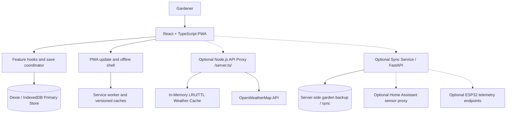
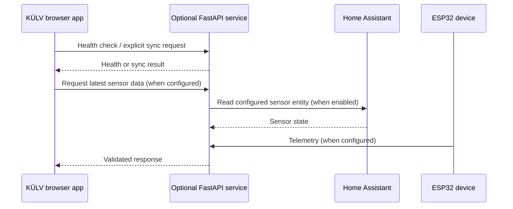

# KÜLV Architecture Guide

> **Scope:** This document describes the existing KÜLV garden-planning application and its optional integrations. It does not define any new hardware module or invent electrical pin assignments.

## 1. Runtime overview and boundaries

KÜLV is strictly **local-first**. The core browser application remains completely useful without a network connection or running backend; IndexedDB (via Dexie.js) is the authoritative, durable primary store for all garden objects, plans, tasks, diary notes, and custom plants.



### 1.1 Local-first PWA boundary
- **Authoritative state:** All active garden plans, planting history, bed configurations, and user diary records are stored in browser IndexedDB (schema version 10).
- **Offline operation:** The application shell, compiled code, styles, and web workers are pre-cached by the Service Worker. A loss of internet connectivity never prevents the gardener from creating or editing beds, consulting planting calendars, or taking notes.
- **Data sovereignty:** No telemetry or user garden geometry is transmitted to external servers without an explicit user export or manual sync operation.

### 1.2 Optional Node.js API proxy (`server.ts`)
In Node-hosted environments (e.g., containerized full-stack deployments), `server.ts` provides a hardened Express server that:
- Serves the static PWA build (`dist/`) with strict production security headers (CSP `script-src 'self'`, `nosniff`, `Referrer-Policy`, HSTS).
- Mediates weather requests via `/api/weather` to prevent leaking third-party API keys (like `OPENWEATHER_API_KEY`) to the client.
- Provides health and readiness endpoints for cloud orchestrators:
  - `GET /health`: Liveness probe returning `200 {"status": "healthy"}`.
  - `GET /readyz`: Readiness probe verifying runtime status and presence of configuration without exposing secret values.
- Executes graceful shutdown handling `SIGTERM` and `SIGINT` signals by closing the listener, waiting for in-flight requests, and enforcing a maximum 10-second drain deadline.

### 1.3 Weather proxy caching and eviction boundary
To protect upstream weather rate limits, user privacy, and network bandwidth, the Node proxy implements an in-memory cache boundary:
- **Coordinate Privacy Rounding:** Client latitudes and longitudes are rounded to 2 decimal places (`Math.round(coord * 100) / 100`), representing approximately ~1.1 km spatial bins. This protects the exact location of the garden while maximizing cache hit rates for nearby coordinates.
- **Cache TTL:** Weather records are retained for 10 minutes (`10 * 60 * 1000` ms).
- **Eviction Boundary (`MAX_WEATHER_CACHE_SIZE = 500`):**
  - Upon inserting new entries, if the cache size reaches the maximum threshold, expired entries are cleaned up first.
  - If the cache remains at capacity after TTL cleanup, the oldest entries (LRU/FIFO) are evicted before inserting new entries.
- **Rate Limiting:** A dedicated rate limiter (`express-rate-limit`) permits 60 requests per 15 minutes per IP.
- **Dependency Injection for Testability:** `createApp()` accepts an optional `AppDependencies` object (`weatherCache`, `weatherLimiter`, `now`), ensuring test suites can assert cache isolation, eviction mechanics, and rate limits without module-level state leakage.

### 1.4 Home Assistant and device sync separation
- **Decoupled Architecture:** Live telemetry from Home Assistant or microcontrollers (ESP32) is treated strictly as an ephemeral auxiliary data stream.
- **Fault Tolerance:** If Home Assistant or the device telemetry endpoint becomes unavailable, times out, or returns corrupted data, the garden planner's local storage, geometry calculations, planting calendars, and UI remain 100% operational.
- **No Direct Hardware Coupling:** The browser client never opens raw socket or GPIO connections; any sensor observation is received through validated, typed schema payloads.

## 2. Browser data flow

1. `App.tsx` initializes the IndexedDB database and loads saved garden items, tasks, journal pages, settings, and custom plants.
2. Feature hooks own task, garden, journal, and settings changes.
3. The save coordinator exposes whether local changes are saving, saved, or still unsaved.
4. The browser uses IndexedDB for its local-first state. JSON import/export and the optional server are explicit portability/synchronization paths; the local saved indicator does not imply a server backup.
5. Heavy modules are lazy-loaded. The app shell and fingerprinted assets use the service worker's versioned caches so previously visited screens can work offline.

## 3. Theme state

The persisted setting `settings.theme` supports `light`, `dark`, and `system`.

- The header theme button saves an explicit light or dark preference to IndexedDB.
- A small local-storage value is only a startup hint to avoid a visible theme flash before IndexedDB opens; IndexedDB remains authoritative.
- When the saved preference is `system`, the app subscribes to operating-system theme changes.
- If browser storage is unavailable, the app can still apply the current-session theme; it must not claim that the preference was saved.

## 4. Optional service connections

The optional FastAPI service is started through Docker Compose and documented in [server/JUHEND.md](../server/JUHEND.md). Before enabling it, configure secrets via environment variables and follow the security instructions in [SECURITY.md](../SECURITY.md).



This is a logical integration diagram only. Actual endpoints and the available readings depend on server configuration and the implemented API; it does not establish a direct hardware connection, GPIO mapping, or universal Home Assistant setup.

## 5. Change and verification boundaries

Keep future changes within the established React/Vite/TypeScript, Dexie/IndexedDB, PWA, and optional FastAPI architecture unless a documented requirement justifies a migration. Do not add hardware assumptions to the garden planner merely because the application can display sensor readings.

Recommended local release checks:

```bash
npm ci
npm run lint
npm run test:coverage
npm run build
npm run test:e2e

python -m pip install -r server/requirements-dev.txt
python -m pytest -q server/test_main.py
```

The CI workflow additionally runs dependency audits and builds the server Docker image. A successful local check proves only the checks actually run in that environment; browser-specific behavior and hosted CI results must be reported separately.

## 6. Coordinate conventions and geometry types

- **Units:** Metric system exclusively. All geometry calculations operate in metres (`m`), areas in square metres (`m²`), volume in litres (`L`) or cubic metres (`m³`). Units conversion is kept strictly in the presentation/UI layer.
- **World Coordinate Space:** Origin `(0, 0)` is at the top-left of the yard bounds. X increases eastward/to the right; Y increases southward/downward.
- **Rotation:** Degrees clockwise (`0°` to `360°`), centered on the item's midpoint `(x + width/2, y + length/2)`.
- **GardenItem polygons:** Custom item vertices are item-local coordinates in metres, relative to the unrotated item origin `(0, 0)`. Rendering, placement, clearances, capacity and solar code convert them through the shared centre-based rotation transform. Yard-boundary vertices remain yard-world coordinates.
- **Polygon invariants:** Simple, non-self-intersecting polygons with at least 3 distinct vertices, non-zero area (> 1e-4 m²), and finite coordinates. Collision operations support concave simple polygons; touching edges are not treated as overlapping area.

## 7. Yard-plan storage and schema version

- **Canonical store:** db.yardPlans; the IndexedDB database schema is currently v10. YardPlan.schemaVersion records the format version used when the plan was written.
- **Fields:** id, name, boundary: Point2D[], northAngleDeg, unit: 'm', updatedAt, schemaVersion.
- **Compatibility mirror:** settings.yard is kept for current UI components and older backups, but the active yard is hydrated from the canonical plan after load or restore.
- **Coordinate convention:** yard polygons are stored in world coordinates; viewport width/length are extents from (0,0), not polygon bounding-box spans. Conversion helpers normalize non-zero legacy origins without translating saved garden objects.
- **Restore policy:** an omitted yardPlans section preserves existing canonical data; an explicit empty list is rebuilt from saved yard settings, the current local settings, or the documented 14×18 m default. This keeps the planner usable and makes the restore deterministic.
- **Scenario snapshots:** each scenario stores its own complete boundary and north angle; older scenarios are upgraded on load.

## 8. Backward-compatibility adapters

- **Rectangles to Polygons:** `getRotatedRectangleCorners` adapts rectangular objects into exact world-space footprints. `getRotatedFootprint` transforms item-local custom polygons through the same rotation convention.
- **Polygon compatibility:** IndexedDB schema v8 migrates clearly world-based pre-v8 GardenItem.vertices to item-local coordinates. Schema v9 completes missing scenario-yard snapshots and backfills history from currently active planting cells. Schema v10 adds durable, versioned crop-rotation overrides and fills missing history provenance without replacing existing records. Legacy JSON backups and older server sync payloads are normalized during restore.
- **Planting Cells to Coordinates:** `adaptPlantingCellToCoordinates` maps discrete grid cells `(gridX, gridY)` into continuous metric local coordinates `(localX, localY)` within the bed.
- **Historical Plantings:** normalizeRecord adapts legacy HistoricalPlanting records to PlantingHistoryRecord with family snapshots. Both the plant planner and selected-bed UI use the versioned history-backed rotation evaluator; past plant names/families are not looked up from today's editable catalogue. persistBedPlantingLifecycle stores cell changes and per-cell history in one transaction; removed rows keep dateRemoved and remain available to crop rotation.

## 9. Feature overlap and clearance rules

- **Central Rule Matrix:** `CENTRAL_RULE_MATRIX` in `src/simulator/yard/featureRules.ts` defines explicit collision rules, operations (`intersects`, `outside_boundary`, `distance_less_than`), severities (`error`, `warning`, `info`), and whether overrides are permitted.
- **Clearance Engine:** `checkClearances` in `src/simulator/yard/clearances.ts` evaluates walking clearances (`0.6m` minimum between beds), service clearances (`0.8m` for water tanks), and boundary offsets (`RULE-CLR-001`, `RULE-CLR-002`, `RULE-CLR-003`).

## 10. Capacity formulas and assumptions

- **Formula:** Candidate positions generated via geometric grid sampling inside usable area `(bedWidth - 2*margin) × (bedLength - 2*margin)`.
- **Spacing priority:** Peenra kohalik kohandus (spacingOverride) > Taimekaardi soovitus (spacingCm) > Tiheduse režiim (cellsPerSquareMeter) > Vaikimisi varu.
- **Assumptions:** Ruutvõrgustik, servavaru vaikimisi pool vahekaugusest (`Sx / 2`).

## 11. Solar-model limitations

- **Engine:** evaluateBedSolarSuitability is the canonical spatial exposure and plant-suitability engine, using SunCalc azimuth/altitude and yard north orientation. Legacy SunCalc helpers remain for compatibility and tests.
- **Sampling:** configurable spatial sampling across the selected local solar day; overview, bed detail and seasonal scenario comparisons share the same calculation path.
- **Limitations:** Geometric shadows assume flat terrain and simplified bounding hulls for buildings and soft ellipses for trees. Presented as spatial estimates, not physical radiometer measurements.

## 12. Crop-rotation rule provenance

- **Provenance:** Rules based on Eesti Maaülikooli mahepõllumajanduse külvikorrajuhis ja FIBL Nordic standards.
- **Rules:** 
  - `ROT-SOLANACEAE-01` (v1.2.0): 4-year interval for Solanaceae (tomatoes, potatoes, peppers).
  - `ROT-BRASSICACEAE-01` (v1.2.0): 4-year interval for Brassicaceae (cabbages, radishes).
  - `ROT-FABACEAE-01` (v1.2.0): 3-year interval for Fabaceae (peas, beans).
  - `ROT-ALLIACEAE-01` (v1.2.0): 3-year interval for Amaryllidaceae (onions, garlic).

## 13. Warning UX, acknowledgement and override behaviour

- **Mandatory UX Contract:** Every warning presents:
  1. Concise title
  2. Severity (`error`, `warning`, `info`) with text badge and icon with accessible name (never color alone)
  3. Explanation of what was evaluated
  4. Affected object or planting
  5. Relevant measurements or rules
  6. Next action
  7. Route to acknowledge or override where permitted
- **Lifecycle:** Managed by `WarningLifecycleManager` (`active`, `acknowledged`, `resolved`, `superseded`, `uncertain`). Overrides are bound to geometry fingerprints; changing dimensions or positions re-evaluates the condition.

## 14. Supported import/export format versions and backend synchronization

- **JSON Backup:** backup and sync payloads carry schema version 10 and include garden items, tasks, journal pages, settings, custom plants, structures, devices, observations, canonical yard plans, planting history, scenarios and deliberate crop-rotation overrides.
- **Backend Sync:** optional push/pull to FastAPI server (/api/sync) with optimistic concurrency revision tracking. The server merges only supplied non-null sections; an explicit empty list clears a section.

## 15. Testing and verification

- **Unit Tests:** `npm run test` (Vitest) covering geometry, clearances, rotations, solar calculations, and Warning UX.
- **Benchmarks:** `src/tests/benchmarkScenes.test.ts` evaluates 50, 200, 500, 1,000 and 2,000-object scenes. CI prints baseline timing measurements before optimization so future changes can be compared to the same synthetic geometry.
- **Accessibility:** Tested in `src/tests/a11y.test.ts` and `src/tests/warningUx.test.ts`, plus Playwright E2E with Axe WCAG 2.2 scanning.
